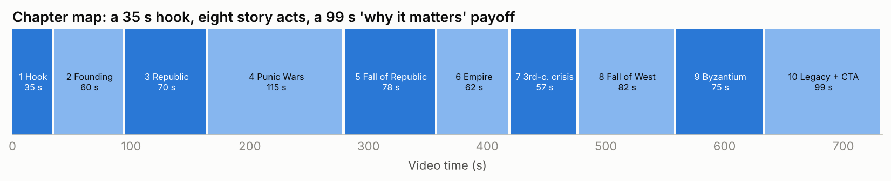
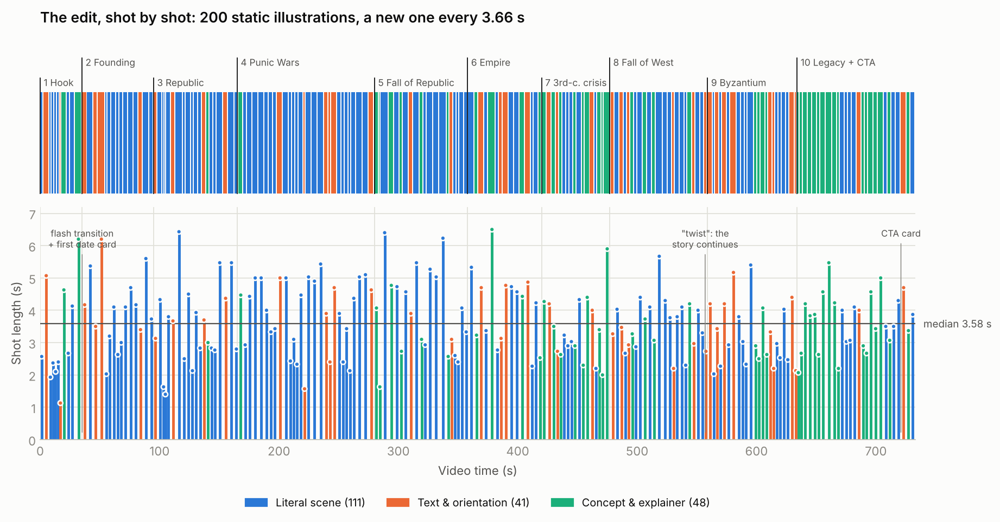
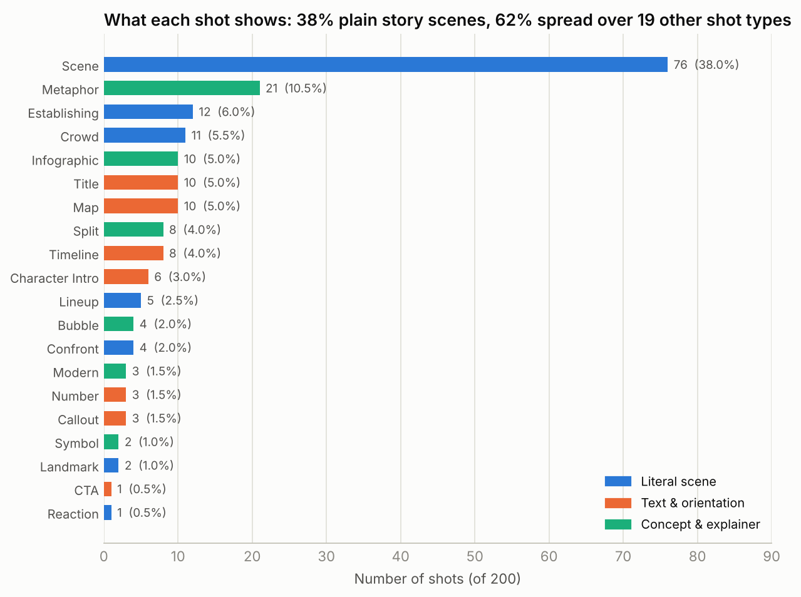
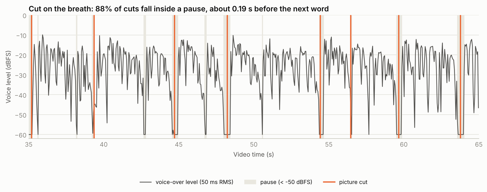
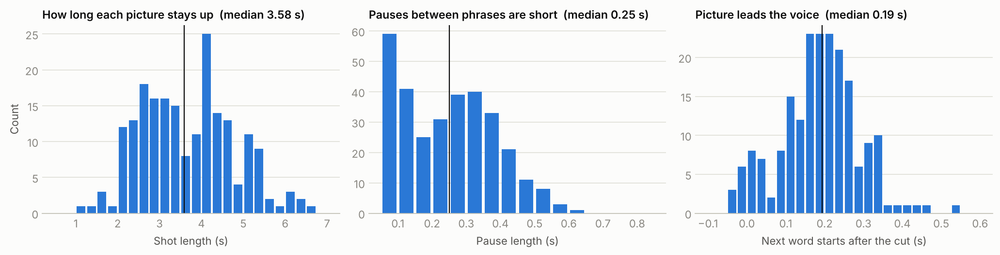

# Teardown: "The ENTIRE History of ROME in 12 Minutes"

**Reference:** [youtu.be/kHCamT4zfH4](https://youtu.be/kHCamT4zfH4) · Genius History · 12:13 · uploaded 26 Aug 2026 · 2560×1440 @ 60 fps
**Performance at analysis time:** 262,725 views on a 21,500-subscriber channel (**12.2 views per subscriber**), 4,258 likes (1.6 %), 291 comments.

This document is the measured breakdown that the rest of the system is built on. Every number comes from the
analysis data in [`analysis/data/`](../analysis/data) (shot list, chapter table, metrics). The method is at the end. The
narration itself is not reproduced here. Beats are paraphrased, and quotes are kept to a few words.

---

## 1. The formula in ten lines

1. **Promise:** "the ENTIRE history of X in N minutes": completeness, compression and a known time cost.
2. **One sentence → one illustration.** 200 shots for 175 sentences; median shot **3.58 s**, median sentence **3.62 s**.
3. **Zero camera motion.** All 200 shots are static stills joined by hard cuts. Only the first chapter break uses a stylised flash transition.
4. **Cut on the breath.** 88 % of cuts land inside a pause, and the next word starts a median **0.19 s** after the cut, so the picture leads the voice.
5. **Dense, energetic narration:** **193 words per minute**, 86 % of the runtime voiced, median pause 0.25 s.
6. **Plain language:** 7th-grade reading level, 12-word median sentence, a "But…" reversal about every 38 s.
7. **Device rotation:** only 38 % of shots are plain story scenes. The rest cycle through maps, date cards, name cards, number cards, split screens, thought bubbles, infographics and visual metaphors.
8. **Chapter bridges:** every chapter ends on a forward-leaning line, and the narration never stops at a chapter seam.
9. **Second hook at 76 %:** a "false ending → twist" re-opens the story just as the viewer expects it to end.
10. **Relevance payoff + callback:** the last 13 % explains why the subject still matters, calls back to the opening promise, and only then asks for the subscribe.

---

## 2. What this video physically is

| Layer | Finding | Evidence |
|---|---|---|
| Pictures | ~200 AI-generated cartoon illustrations, one consistent style | contact-sheet review of all 200 shots |
| Motion | **None.** No zoom, no pan, no in-image animation | optical-flow similarity fit on all 21,985 frames: zoom = 1.000, pan = 0, local motion = 0 for every shot |
| Transitions | 198 hard cuts + 1 flash transition (dip, warm flash, fade-in) at the first chapter break (35.2 s) | frame-difference signal around every cut |
| On-screen text | Baked into the illustrations by the image model (names, dates, numbers, labels) | visual review |
| Voice | One male narrator, almost certainly TTS | ~22 s of absolute digital silence between phrases (no room tone), perfectly even loudness (LRA 2.9 LU) |
| Music | **None** | 138 pauses ≥ 0.25 s fall below −50 dBFS |
| SFX | **None** | cuts that sit inside pauses are silent |
| Mix | −17.7 LUFS integrated, true peak +0.5 dBFS, dual-mono | EBU R128 measurement |

**Implication:** this is the cheapest kind of faceless production there is: a script, a TTS voice, ~200 still images and an
editor that places one image per sentence. Its performance shows that **the script, the visual literalism and the
pacing carry the retention, not the motion design.** That is good news for a reusable system: the hard parts can be
written down as rules.

---

## 3. Structure

| # | Chapter (YouTube chapter title) | Start | Length | Share | Words | WPM | Shots | Avg shot |
|---|---|---|---|---|---|---|---|---|
| 1 | Hook ("The legacy of Rome") | 0:00 | 35 s | 4.8 % | 114 | 195 | 11 | **3.20 s** |
| 2 | Founding and kingdom era | 0:35 | 60 s | 8.2 % | 206 | 206 | 15 | 3.99 s |
| 3 | The Roman Republic | 1:35 | 70 s | 9.5 % | 230 | 197 | 20 | 3.53 s |
| 4 | Expansion and the Punic Wars | 2:45 | 115 s | 15.7 % | 376 | 196 | 30 | 3.93 s |
| 5 | Crisis and the fall of the republic | 4:40 | 78 s | 10.6 % | 264 | 203 | 19 | 3.94 s |
| 6 | The birth of the empire | 5:58 | 62 s | 8.5 % | 203 | 197 | 15 | 4.10 s |
| 7 | Crisis of the 3rd century | 7:00 | 57 s | 7.8 % | 174 | 183 | 17 | 3.41 s |
| 8 | The fall of the west | 7:57 | 82 s | 11.2 % | 244 | 179 | 23 | 3.53 s |
| 9 | The Byzantine legacy | 9:19 | 75 s | 10.2 % | 220 | 176 | 23 | 3.26 s |
| 10 | Rome's enduring influence (+ CTA) | 10:34 | 99 s | 13.5 % | 327 | 198 | 27 | 3.66 s |

**Observations**

- **Shape:** a 5 % hook, then eight acts of 8–16 % each, then a 13 % "why it matters" payoff. The longest act is the war
  act (the rival "boss fight"), at 16 %.
- **Pace never drops.** WPM stays between 176 and 206 in every chapter, and shot length stays near 3.5–4 s. There are no slow
  sections and no breathers.
- **No seams.** Several YouTube chapter markers fall mid-sentence. The narration runs straight through, so a viewer
  scrubbing chapters lands mid-thought and keeps listening. Each act also ends on a **bridge line** that points forward
  (paraphrased):

| Act ends with (paraphrase) | Function |
|---|---|
| unity turns the young state into a war machine | sets up expansion |
| victory brings wealth, and the wealth is a curse | flips success into the next crisis |
| an assassination sparks a war of revenge | carries momentum across the seam |
| the golden age compared to a candle that burns down | metaphor that foreshadows decline |
| the next ruler is named just before the cut | names the next protagonist before the seam |
| the narrator announces a twist most people forget | **re-hook at 76 %** |
| a direct question about why it matters today | pivots into the relevance payoff |

---

## 4. The hook, second by second (0–35 s)

11 shots in 35 s (3.2 s average, faster than the body). The hook works as a trailer for the whole video.

| Time | Beat (paraphrased) | Picture | Device |
|---|---|---|---|
| 0.0 | an "imagine…" opening on a small, muddy riverside village | humble farming village | **second-person immersion + humble origin** |
| 2.6 | …which grew until it ruled the whole Mediterranean | map: empire in red at its peak | **extreme before/after contrast** |
| 7.6–14.0 | farmers → monumental stadiums → long-lasting roads → laws still in use | farmers → arena → road → law court | **three proofs of relevance**, one image each |
| 16.4 | the subject's name, said as its own short sentence | big title card over a sunset skyline | **title drop** (1.1 s, the shortest shot in the video) |
| 17.6 | the story framed as a rollercoaster of four big emotions (brilliance, violence, greed, survival) | figures on a roller coaster | **emotional menu** drawn as a literal metaphor |
| 22.2 | a band of outcasts became powerful enough to shape the modern world | outcasts at night | **underdog framing + big claim** |
| 24.9 | (continued) | imperial landscape of aqueducts | scale |
| 29.0 | a two-part question: how did it happen, and how did outlaws build something that lasted 2,000 years? | question mark between a hut and the empire map | **central paradox question** (open loop for the whole video) |
| 35.2 | "our story starts in" + the founding year | flash transition → parchment timeline with arrow on the date | **date anchor** starts the chronology |

The idea of an empire that *refused to die* is planted here and paid off twice: at the twist (76 %), and in the
final line, which returns to the same image of a city that won't be forgotten.

---

## 5. Script mechanics

| Metric | Value | What it means |
|---|---|---|
| Words / runtime | 2,358 words / 12:13 → **193 WPM** | fast documentary pace (typical narration: 140–160) |
| Sentences | 175, mean 13.5 words, **median 12**, p10 6, p90 23, max 34 | short, mostly single-idea sentences |
| Punch sentences (≤ 6 words) | 13.7 % | one in seven is a jab |
| Reading level | Flesch 68.9 · **FK grade 7.0** · 10.9 % words with 3+ syllables | simple vocabulary for a big subject |
| "But" | 19 total, 8 sentences open with it | a reversal roughly every 38 s |
| Questions | 3 (two in the hook, one at the final pivot) | questions are reserved for structural moments |
| Numbers | 33 numerals (2.7 / min): dates, army sizes, years, distances | concreteness and credibility |
| Proper nouns | ~12 per minute | dense, but each one is introduced in a plain sentence |
| "you / your" | 12 (clustered in the hook and payoff) | direct address where relevance matters |

### Recurring script devices (with paraphrased examples)

1. **Problem → fix → new problem.** Each era is framed as a puzzle with a protagonist: *the founder had a problem: his
   city was empty → so he opened it to fugitives*. This cycle repeats every 20–40 s and works like a chain of mini cliffhangers.
2. **"But" reversals.** Success turns into a curse, the saviours turn out to be the killers, the golden age turns out to be a candle.
3. **Boss framing.** Antagonists and turning-point rulers get a name card and modern framing (the general who becomes
   "the final boss of the republic"). Stakes escalate act by act: neighbours → a rival superpower → civil war → internal rot → invaders → cannons.
4. **Modern idiom on an ancient subject.** Gamer and internet phrasing ("final boss", a rival "deleted from the
   timeline", "debt dodgers") gives roughly one wink per minute and keeps the tone young.
5. **Write metaphors that can be drawn.** Every figure of speech is illustrated literally: rollercoaster →
   roller coaster; "walking corpse" → a zombie legionary; "performed surgery on the empire" → a cleaver chopping a map;
   "shield of Europe" → a shield deflecting arrows; "like a candle" → a melting candle.
6. **Concrete numbers at first mention**, often shown on screen as a number card ("40,000 MEN", "37 WAR ELEPHANTS", "AGE 18").
7. **Inline micro-definitions:** a Latin term followed by "which means…", or "historians call this…".
8. **Credibility hedges on legends:** "according to the legend", "supposedly". They keep the myth while flagging it.
9. **Irony beats:** the last western emperor shares the founder's name, and the assassins who meant to save the
   republic killed it. Each one is a small "huh!" moment that rewards attention.
10. **Immersion asides:** an "if you lived back then…" sentence listing everyday comforts makes the golden age tangible.
11. **False ending → twist (76 %).** The thumbnail promises 753 BC – 476 AD, and when 476 arrives the narrator announces the
    twist that most people forget. This is the strongest re-hook in the video.
12. **Relevance payoff:** languages, senates and republics, written law, architecture, the calendar and money
    symbols, each with its own illustration.
13. **Moral complexity, then thesis:** "a mess of contradictions" (brutality *and* justice), then the thesis that the
    subject survives as an *idea*. This lifts the ending above a list of facts.
14. **CTA last.** Subscribe requests appear only in the final ~25 s, after the payoff, so the ask costs no retention.

---

## 6. Visual mechanics

### Shot-type taxonomy (all 200 shots classified by hand)

| Family | Type | Count | Share | What it is | When it is used |
|---|---|---|---|---|---|
| Literal scene | SCENE | 76 | 38 % | characters acting out the sentence | default for narrative sentences |
| | ESTABLISHING | 12 | 6 % | landscape / city panorama | new place or era |
| | CROWD | 11 | 5.5 % | masses of figures (mobs, armies, fleets) | scale, public mood |
| | LINEUP | 5 | 2.5 % | row of characters | "seven kings", final cast shot |
| | CONFRONT | 4 | 2 % | two rivals facing off | rivalry setup |
| | LANDMARK | 2 | 1 % | iconic building | anchors identity |
| | REACTION | 1 | 0.5 % | close-up facial reaction + icon | emotional punctuation |
| Text & orientation | MAP | 10 | 5 % | stylised map, colour-coded territory | expansion, splits, losses |
| | TITLE | 10 | 5 % | big lettering over a scene ("PUNIC WARS") | new era / concept / event |
| | TIMELINE | 8 | 4 % | parchment timeline with marker on a year | **date anchor**, usually at act starts |
| | CHARACTER_INTRO | 6 | 3 % | name in large letters + hero pose | first appearance of a key figure |
| | NUMBER | 3 | 1.5 % | huge number + supporting scene | first mention of a striking figure |
| | CALLOUT | 3 | 1.5 % | label/arrow/sign on a scene | naming a thing or a group |
| | CTA | 1 | 0.5 % | like & subscribe card | final 2 % |
| Concept & explainer | METAPHOR | 21 | 10.5 % | literal drawing of a figure of speech | abstract ideas, transitions |
| | INFOGRAPHIC | 10 | 5 % | diagram, chart inset, arrows | mechanisms, comparisons |
| | SPLIT | 8 | 4 % | two-panel contrast | rich vs poor, West vs East, before vs after |
| | BUBBLE | 4 | 2 % | thought/speech bubbles | what people fear or say |
| | MODERN | 3 | 1.5 % | present-day setting | legacy section bridge |
| | SYMBOL | 2 | 1 % | single symbolic image (question mark, lone figure in smoke) | open questions, aftermath |

**Rules visible in the data**

- A **device shot every ~2.6 shots** (62 % non-plain-scene) keeps the eye from habituating.
- **Date cards open acts.** Timeline cards appear at 35 s, 95 s, 424 s, 530 s, 546 s, 610 s, 628 s and 684 s.
- **Name cards on first appearance** of each major figure: the general, the dictator, the reformer, the convert, the conqueror.
- **The legacy section switches families:** chapter 10 is mostly concept/explainer shots (green in Fig. 1), with modern
  settings, infographics and metaphors.
- Device shots are held slightly shorter (titles average 2.96 s) and map/split shots slightly longer (4.2 s); reading
  takes time.

### Art direction (as observed)

- Hand-inked cartoon look: uniform thick black outlines, flat colours, light texture. Detailed environments with
  very simple characters (round white heads, dot eyes, eyebrow-driven emotion, tube limbs, period costume).
- Comedy is carried by expressions and props: X-eyes for death, comic anger bursts, sweat drops, oversized symbols.
- Palette: parchment and earth (≈ #857858, #655746, #e2d0a7), ink black, with accents of **imperial red (#ac412d)**, **gold (#deac50)**
  and **sky blue (#78c3e7)**. Median saturation is moderate (81/255) and median brightness mid-high (139/255).
- On-screen lettering is generated inside the image: bold rounded sans for names and numbers, a red hand-lettered serif for
  crises, a parchment tag for dates.

---

## 7. Edit mechanics

| Rule | Measured |
|---|---|
| Cut on a sentence boundary | **145 / 199 cuts (73 %)** |
| Cut on a clause boundary (comma / breath inside a sentence) | 40 (20 %) |
| Cut mid-phrase | 14 (7 %) |
| Cut lands inside a pause | 175 (88 %), at ~42 % of the way into the pause |
| Next word starts after the cut | median **0.19 s** (IQR 0.13–0.25 s) |
| Sentences split across two images | 44 / 175 (25 %), the long ones |
| Words per shot | median 12 (p10 7, p90 17) |
| Shot length | median 3.58 s · p10 2.30 · p90 5.07 · min 1.13 · max 6.50 |
| Shots per minute | 16.4 |

**Editing algorithm (reconstructed):** lay the TTS clips end to end with short gaps, then place each image so it starts
~0.2 s before its sentence begins. Split any sentence that would hold one image longer than ~5 s at its most natural
comma. That is the whole edit.

---

## 8. Voice & audio

| Metric | Value |
|---|---|
| Voice | one adult male narrator, baritone, **median F0 117 Hz** (p5–p95: 86–188 Hz) |
| Expressiveness | pitch SD **4.1 semitones**, p5–p95 range 13.6 semitones (animated storytelling, not a flat read) |
| Pace | 193 WPM, voiced 86 % of the time |
| Pauses | 313 pauses ≥ 80 ms; median 0.25 s, p90 0.43 s, longest ~0.6 s |
| Loudness | −17.7 LUFS integrated, LRA 2.9 LU, true peak +0.5 dBFS |
| Bed / SFX | none |

**Read:** a confident "storyteller" read that is quick, bright and punchy, with no music to compete. The −17.7 LUFS mix is
about 3.7 dB quieter than YouTube's −14 LUFS reference. YouTube turns loud videos down but never turns quiet ones
up, so this video plays quieter than its neighbours. **That is an easy improvement.**

---

## 9. Why it retains (the retention model)

| Viewer need | How the video serves it |
|---|---|
| "Is this worth my time?" | Title promises completeness in a fixed time; the hook previews the whole arc in 35 s |
| Novelty (eyes) | new picture every ~3.6 s, a device shot every ~2.6 shots, humour in expressions |
| Low effort (brain) | each picture shows exactly what is being said; grade-7 language; one idea per sentence |
| Orientation | dates on screen, maps, "Our story starts in…", character name cards |
| Curiosity | central paradox question; "But…" reversals; chapter bridge lines; twist at 76 % |
| Stakes | escalating rivals with "boss" framing; numbers that make scale concrete |
| Meaning | relevance proofs in the hook; legacy payoff; moral complexity; idea-level thesis |
| Reward for finishing | callback to the hook's phrasing; CTA only after the payoff |

---

## 10. Where it can be beaten (opportunities to A/B test)

1. **Loudness:** master to −14 LUFS / −1 dBTP. It is free, and the video sounds as loud as its competitors.
2. **Subtle motion:** a 2–5 % push or pan per still adds perceived production value at zero script cost. Test this against the faithful static cut.
3. **Low music bed and accent SFX:** a whoosh on act transitions and a "pop" on name/number cards. Keep the bed ~20–24 dB under the voice.
4. **Chapter markers aligned to bridge lines** (start chapters on the first sentence of an act) for cleaner navigation.
5. **Character consistency:** recurring figures (e.g. the main ruler across several shots) drift between images.
   Use a character sheet and reference images.
6. **Vertical repurposing:** the long-form has no captions. Shorts cut from it need burned-in word captions and a 2× faster cut rhythm.
7. **Hook polish:** the paradox question arrives at 26–31 s. In shorts it must arrive in the first 2 s.

---

## 11. Method (reproducible: `python -m chronicle analyze <video> --audio <file>`)

- **Media:** 854×480 30 fps MP4 and 44.1 kHz MP3 of the published video.
- **Shots:** PySceneDetect content detector (threshold 27, min 8 frames). Adaptive detector cross-check: 199 vs 200 shots.
- **Motion:** Farnebäck optical flow on 320×180 frames, robust similarity fit (scale, rotation, translation) per frame
  pair; residual flow as local animation. Encoder keyframe refreshes (0.03–0.09 % pixel changes at 0.5 s multiples) were
  ruled out as content changes.
- **Speech:** faster-whisper `medium.en` with word timestamps (2,358 words); sentence and clause segmentation from punctuation.
- **Audio:** EBU R128 (ffmpeg `ebur128`), silence runs below −50 dBFS (10 ms hop), pYIN F0 (60–400 Hz).
- **Pictures:** middle frame of every shot reviewed on contact sheets and classified into the 20 types above. Palette from
  k-means (k = 14) over all shots.
